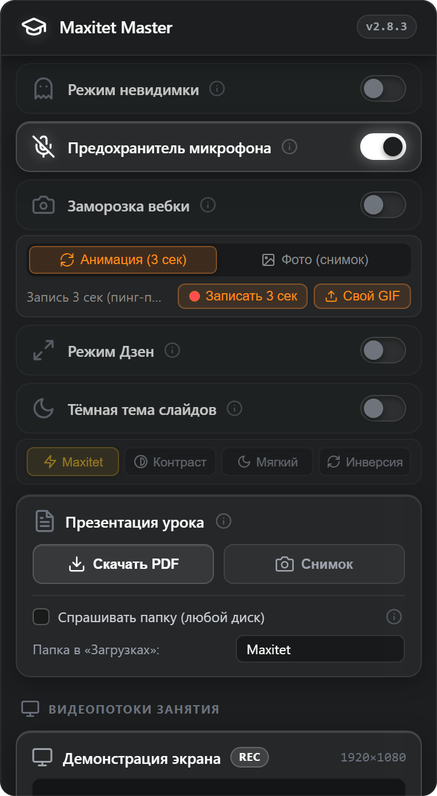

  

  # Maxitet Master

  Расширение для удобных занятий на платформе **М.Класс** ([vision.maximumtest.ru](https://vision.maximumtest.ru)).

  
  
  

   

  

---

## Функции и горячие клавиши

| Функция | Хоткей | Описание |
| :--- | :---: | :--- |
| **Режим «Дзен»** | <kbd>Z</kbd> | Слайд на весь экран без лишних панелей (зум: <kbd>+</kbd> / <kbd>-</kbd> / <kbd>0</kbd>) |
| **Плавающий чат** | <kbd>C</kbd> | Окно чата поверх слайда в Дзене (<kbd>Esc</kbd> — закрыть) |
| **Тёмная тема** | <kbd>D</kbd> | 4 пресета инверсии слайдов (<kbd>Shift</kbd> + <kbd>D</kbd> — переключить пресет) |
| **Снимок слайда** | <kbd>S</kbd> | Копирование текущего кадра в буфер обмена |
| **Скачивание в PDF** | | Экспорт всех слайдов урока в один документ |
| **Режим невидимки** | | Вкладка всегда активна для сайта, даже если браузер свёрнут |
| **Предохранитель микрофона** | | Защита от случайного включения звука на паре |
| **Заморозка камеры** | | Зацикленная анимация, GIF или стоп-кадр вместо вебкамеры |
| **Картинка в картинке** | | Вынос видео преподавателя или экрана в отдельное окно (PiP) |

> [!NOTE]
> Хоткеи работают на любой раскладке и отключаются при вводе текста в чате. Для полного затемнения сайта рекомендуем [Dark Reader](https://darkreader.org/).

---

## Установка

1. Скачайте архив `extension.zip` из [последнего релиза](https://github.com/mqdnx/mm/releases/latest) и распакуйте.
2. Перейдите в браузере по адресу `chrome://extensions/` и включите **«Режим разработчика»**.
3. Нажмите **«Загрузить распакованное расширение»** и выберите распакованную папку `extension`.
